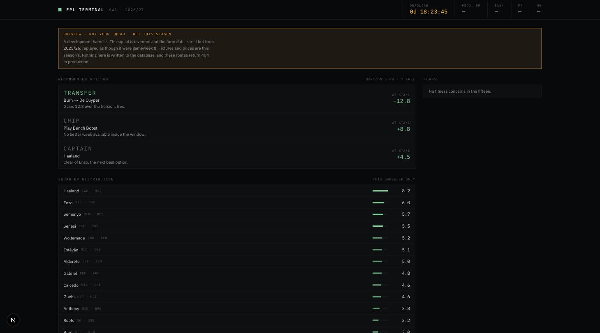
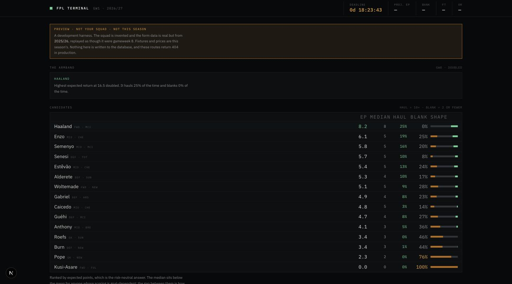
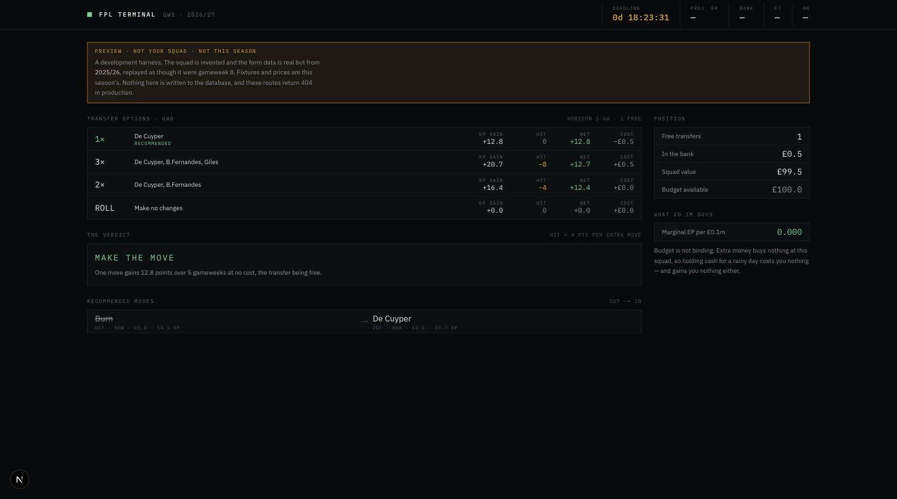
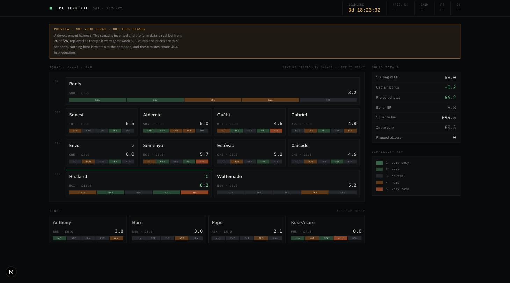
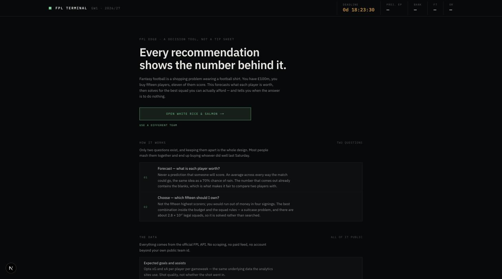

# FPL Edge

A Fantasy Premier League decision engine. It forecasts what every player is
worth, solves for the best squad the budget allows, and shows the number behind
every recommendation — including when the recommendation is to do nothing.

Built for one manager, usable by anyone with a team id. No sign-in: an FPL team
id is public data, not a credential.



*Ranked by what the decision is worth, not by the biggest number. Haaland's 8.2
is the largest figure on the screen, but Enzo sits at 6.0 behind him — so the
armband is worth +4.5 and ranks third.*

---

## Only two questions

Fantasy football is a shopping problem wearing a football shirt. £100m, fifteen
players, eleven of whom score. There are exactly two questions in it, and
keeping them apart is the whole design:

1. **What is each player worth?** A forecasting problem. The answer is an
   average across every way the match could go — never a prediction that
   someone *will* score.
2. **Given that, which fifteen should I own?** A shopping problem. Not the
   fifteen highest scorers; the best *combination* inside the budget and the
   squad rules. About 2.8 × 10²⁷ legal squads, so it is solved rather than
   searched.

Most tools mash the two together and end up recommending whoever did well last
Saturday.

---

## Architecture

```mermaid
flowchart TB
    subgraph external["Outside"]
        FPL["FPL API<br/><i>unauthenticated</i>"]
        LLM["Anthropic API<br/><i>optional</i>"]
    end

    subgraph jobs["Scheduled jobs — GitHub Actions"]
        direction LR
        J1["02:00 static<br/>prices, transfers"]
        J2["06:00 squad<br/>your picks"]
        J3["08:00 results<br/>played gameweeks"]
        J4["09:00 journal<br/>record + score"]
        J1 --> J2 --> J3 --> J4
    end

    DB[("Postgres — Supabase<br/>RLS deny-all, service role only")]

    subgraph engine["lib/engine — pure, no I/O"]
        direction TB
        MIN["minutes.ts<br/><i>the dominant input</i>"]
        EP["expected-points.ts"]
        DIST["distribution.ts<br/><i>shape, not centre</i>"]
        OPT["optimiser.ts<br/><i>MIP + LP dual</i>"]
        MIN --> EP
        EP --> DIST
        EP --> OPT
    end

    subgraph screens["Screens — Next.js, server-rendered"]
        direction LR
        S1["/squad"]
        S2["/transfers"]
        S3["/captain"]
        S4["/chips"]
        S5["/history"]
    end

    FPL -->|"sync"| jobs
    jobs -->|"upsert"| DB
    DB -->|"rows"| engine
    engine -->|"projections"| screens
    J4 -.->|"context"| LLM
    LLM -.->|"prose only"| DB

    GLPK["glpk.js<br/><i>WASM solver</i>"] -.->|"injected"| OPT

    style engine fill:#0d1f17,stroke:#2f6b4f
    style external fill:#1f1a0d,stroke:#6b5a2f
    style DB fill:#0d1417,stroke:#2f5a6b
```



Three rules hold the shape:

**`lib/engine/**` is pure.** No database, no `fetch`, no environment. Everything
is passed in and everything comes back as a value. That is what makes the model
unit-testable and what makes `scripts/backtest.ts` able to replay a whole season
through it. The solver is WASM and needs async init, so it is injected through
an interface rather than imported.

**The LLM never touches the objective.** It receives numbers the engine has
already computed and is forbidden from inventing or recomputing any. With no
API key the engine works exactly as before and the brief simply does not render.

**Game rules and model constants are different things.** `lib/rules.ts` holds
facts about FPL — goal points, budget, hit cost — and is never tuned.
`lib/engine/constants.ts` holds tunables, each with a comment on where the
number came from, tuned against the backtest rather than intuition.

---

## What is built

### Screens

| Screen | What it does |
|---|---|
| `/` | Landing page — what it does, the data, the calculations, and the limits |
| `/t/{id}` | This week's actions, ranked by what the decision is worth |
| `/t/{id}/squad` | Pitch view, per-player EP, five-fixture difficulty strips, flags |
| `/t/{id}/transfers` | Roll / 1 / 2 / 3 moves, each with gain, hit, net, and the budget shadow price |
| `/t/{id}/captain` | The outcome *distribution* — haul, blank, ceiling, floor |
| `/t/{id}/chips` | 38-week timeline, and which gameweek to play each chip |
| `/t/{id}/history` | Decisions recorded before the deadline, scored after |
| `/t/{id}/leagues` | Mini-leagues, discovered from your entry |
| `/preview/*` | Dev-only harness — 404s in production |

### The engine

| Module | What it solves |
|---|---|
| `minutes.ts` | Will he play? The highest-leverage input in the project |
| `expected-points.ts` | Appearance, xG, xA, clean sheets, defcon, bonus, cards |
| `set-pieces.ts` | Penalty and corner duty, without double-counting penalty xG |
| `prior-season.ts` | Last season's rates, for the gameweeks before form exists |
| `news-signal.ts` | What team news says that the percentage does not |
| `distribution.ts` | The shape of an outcome, by convolution |
| `captain.ts` | Because doubling is linear and cannot change a ranking by mean |
| `optimiser.ts` | MIP for the fifteen, LP relaxation for what £0.1m buys |
| `transfers.ts` | Each transfer count pinned by a retention floor, compared after hits |
| `chips.ts` | Chip timing as a bipartite assignment, not a threshold |
| `best-xi.ts` | Eleven from fifteen, by enumeration — seven legal formations |
| `free-transfers.ts` | Derived, because the API never reports it |
| `price-model.ts` | Price movement from transfer momentum, halved for the sell-on fee |
| `frontier.ts` | Isotonic value curve — a diagnostic that must never enter the objective |

402 tests. `npm run check` runs typecheck, lint and the suite.

---

## Screens

### Captain — the one that is genuinely different



Every other screen ranks on expected points. Doubling is linear, so it cannot
change which player has the highest mean — "highest EP" is only the right
captain if you are indifferent to risk. Defending a lead wants the highest
floor; chasing wants the fattest tail. The shape bar is blank / ordinary / haul.

### Transfers



Every transfer count is its own solve, pinned by a retention floor, compared
*after* the four-point hit. Rolling needs no solve at all and is always offered.

### Squad



### Landing



*Screenshots are from the dev preview harness — real players, real fixtures,
last season's form replayed as gameweek eight.*

---

## Running it

```bash
npm install
cp .env.example .env.local   # fill in what you have; the app degrades without it
npm run dev
```

`npm run check` runs the typecheck, the linter and the test suite.

### Seeing the screens before a gameweek exists

Every ranked screen refuses to rank until the model has something to tell
players apart with. To see them working before then:

```bash
npm run backtest   # once, to populate .backtest-cache/
npm run dev        # then open /preview
```

The preview replays **real 2025/26 results**, matched onto this season's players
by name — around three quarters match, and the rest are new signings and
promoted-club players who genuinely have no Premier League history. Fixtures and
prices are this season's; the squad is invented, picked on last season's points
the way a person would, so the optimiser has real disagreements to show.

Three fences keep it out of production: `app/preview/layout.tsx` returns 404
when `NODE_ENV` is production, nothing under `lib/preview/` writes to the
database, and every preview page carries a banner. The real routes never import
from `lib/preview/`.

### Checking the brief

```bash
npm run brief:check                  # the real call, against the preview
npm run brief:check -- --prompt-only # what would be sent, without sending it
```

The dry run is the fastest way to audit exactly what the model is and is not
told — which matters, because the whole safety argument is that it only ever
sees numbers the engine already computed.

---

## Routes and sign-in

```
/                      landing — how it works, and the way in
/?switch=1             the landing page, forcing the team-id form
/t/{entryId}           dashboard, squad, transfers, captain, chips, history, leagues
/preview/*             dev-only harness
```

**There is no sign-in, and there is not going to be one.** An FPL entry id is
public: `entry/{id}/` is unauthenticated and the FPL site reads it for every
mini-league table. A password would protect nothing and imply the opposite.

`/` resolves a team from the `fpl_entry` cookie, then `FPL_TEAM_ID`. The cookie
wins on purpose — a configured team id is the deployment's default, not a lock.

### Where the keys go

| | Supabase pair | `FPL_TEAM_ID` | `ANTHROPIC_API_KEY` |
|---|---|---|---|
| `.env.local` | yes | optional | to run `brief:check` |
| GitHub Actions | yes | yes | to write the brief |
| **Vercel** | **yes** | optional | **no** |

Briefs are *written* by the sync job and *read* by the app. Those are different
processes on different machines, and the app has no use for a key.

---

## Scheduled jobs

Four, on GitHub Actions rather than Vercel Cron — see `docs/cron.md` for why.
The order is not arbitrary:

| UTC | Job | Needs |
|---|---|---|
| 02:00 | `static` | after the 01:30 UK price change, in both BST and GMT |
| 06:00 | `squad` | — |
| 08:00 | `results` | late enough that bonus is confirmed and `data_checked` is set |
| 09:00 | `journal` | the squad, the day's prices, *and* results |

`journal` runs last because it does two things whose inputs differ: it records
what the engine advises for the gameweek still **open**, and it scores decisions
for gameweeks whose results have landed.

Recording only ever happens for the open gameweek. A recommendation written
after a deadline is hindsight wearing a timestamp, and a journal containing any
of those cannot be used to judge anything.

`npm run sync -- history` is manual: it pulls four seasons of per-player history
and skips anyone already recorded, so the first run is ~600 requests and every
run after it is a handful.

---

## Database

Supabase project `ehfuwpslwzxsjjaatgng`. All nine migrations in
`supabase/migrations/` are applied.

**Access is server-side only, and the schema enforces it.** Every table has RLS
enabled with *no policies* — a deliberate deny-all. The publishable key can read
and write nothing, so all access goes through `SUPABASE_SERVICE_ROLE_KEY`, which
bypasses RLS. `lib/db/client.ts` imports `server-only`, so a mistaken client
import is a build error rather than a leaked credential.

Supabase's linter reports `rls_enabled_no_policy` at INFO level for every table.
That is the intended state, not a gap to close.

**Reads over 1000 rows must page.** PostgREST caps a response at 1000 rows and
does so *silently* — no error, no flag. `fetchAll` in `lib/db/queries.ts` exists
for that, and season history, recent stats, transfer snapshots, gameweek points
and price history all use it. A new query that can exceed a thousand rows and
does not page will not fail; it will quietly make the model worse.

After changing a migration, regenerate the types with `npm run db:types`.

---

## Data

Everything comes from the official unauthenticated API at
`https://fantasy.premierleague.com/api/`. No scraping, no paid feed.

`docs/data-and-calculations.md` lists every field consumed, what each is used
for, and — as usefully — the fields deliberately ignored and why. It also
answers whether the FPL API is sufficient. Short version: yes, and the most
valuable thing found was four seasons of history sitting in an endpoint the app
was not calling.

Three things about the API shape the code:

1. **It is CORS-blocked in the browser.** Every call is server-side.
   `lib/fpl/client.ts` imports `server-only`.
2. **It rejects some default fetch user-agents.** The client sends a browser UA.
3. **It is untyped and changes shape.** Every response is `unknown` until it
   passes a Zod schema. Unknown fields are ignored; missing known fields are
   fatal. A season of quietly-corrupted history is unrecoverable.

Two endpoint choices worth knowing:

- Per-gameweek history comes from `event/{gw}/live/`, which returns every
  player's stats in one response — 38 calls a season against roughly 700 to
  `element-summary/`.
- `entry/{id}/event/{gw}/picks/` returns 404 until a deadline has passed. That
  is a state, not an error, and `getEntryPicksIfAvailable` treats it as one.

---

## Honest state

The model **beats a naive baseline by 2.6%** over the 2025/26 season and
**loses to it on forwards** by 3.9%. That is a real edge and a thin one.

It has never run against a live gameweek.

Both decision screens gate on whether the model can separate players at all.
Before any gameweek is played that rests on last season, so attacking rates are
real but **minutes are not** — every player carries the same flat starting
probability, and the screens say so rather than presenting a nailed starter and
a rotation risk as though the model could tell them apart.

---

## Where this is going

`docs/next-steps.md` is the working plan: known gaps that are real defects, and
an optimisation roadmap ordered by payoff. Start there rather than at PLAN.md
§11 if you are picking the work up cold — PLAN.md is the spec, that file is the
state.

`docs/multi-user-and-ai.md` answers two questions deliberately: what it takes to
let anyone use this with their own team id, and what an LLM can genuinely
contribute — one thing, and it is not picking the squad.

**[How the engine thinks](https://claude.ai/code/artifact/33678294-5060-4a74-8f0a-84faed44b8c5)**
is the same explanation for someone who does not read code.

---

## Layout

```
app/                 routes — /, /t/[entryId]/*, /preview/*, /api/cron/*
components/          chrome, ui primitives, and one board per screen
lib/rules.ts         rules of the game — never tuned
lib/engine/          the model — pure functions, no I/O
lib/squad/           rows to projections — the one conversion everything shares
lib/fpl/             API client, Zod schemas, gameweek resolution
lib/db/              Supabase client, sync jobs, generated types — server-only
lib/llm/             the brief — returns null with no key
lib/preview/         dev-only harness
lib/format.ts        the render boundary — the only place £ appears
supabase/migrations/ schema
tests/               Vitest — engine and pure logic only
design/              vendored Claude Design canvas, the visual source of truth
```

`design/fpl-terminal.dc.html` is the source of truth for the visual system —
every colour, type size and border weight in `app/globals.css` came from it. If
a value in the code disagrees with the canvas, the canvas wins.
